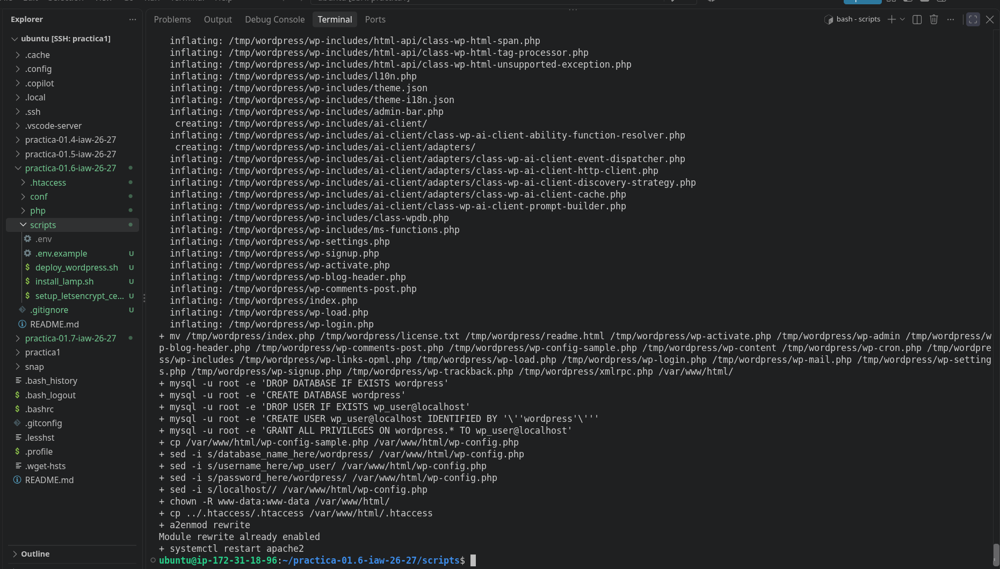
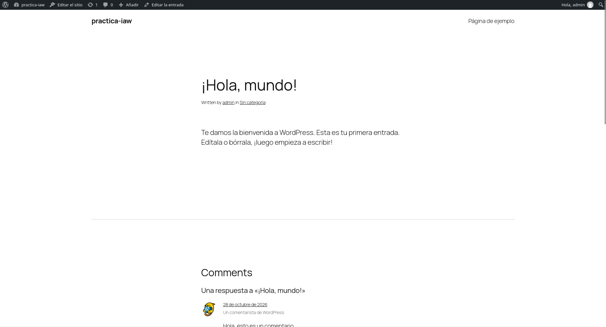
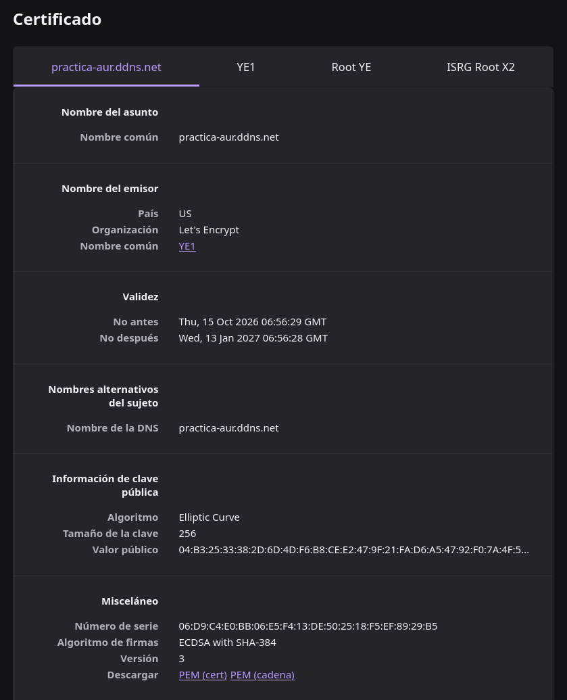

# Práctica 1.6: Despliegue Automatizado de WordPress sobre LAMP con HTTPS y Certificados de Let's Encrypt

Este repositorio contiene el conjunto de scripts en Bash y archivos de configuración necesarios para automatizar la instalación de la pila LAMP sw la configuración de un sitio web seguro mediante un certificado SSL real emitido por **Let's Encrypt** (utilizando **Certbot**), y la instalación y despliegue automatizado de la última versión de **WordPress**.

## Resultados a obtener

* **Ejecucion del script sin errores:**

   

* **Acceso a la web de wordpress:**

   

* **Vista de las caracteristicas del certificado de la web:**

   

## Estructura del repositorio

```
.
├── conf
│   ├── 000-default.conf
│   └── virtualhost.conf.template
├── .gitignore
├── .htaccess
│   └── .htaccess
├── php
│   └── index.php
├── README.md
└── scripts
    ├── .env.example
    ├── deploy_wordpress.sh
    ├── install_lamp.sh
    └── setup_letsencrypt_certificate.sh
```

## 1. Archivos de Configuración (`conf/`)

### `conf/000-default.conf`

Archivo de configuración inicial del VirtualHost de Apache para atender peticiones por el puerto 80 durante la instalación base de la pila LAMP.

```
<VirtualHost *:80>
  DocumentRoot /var/www/html/

  DirectoryIndex index.php index.html

  ErrorLog ${APACHE_LOG_DIR}/error.log
  CustomLog ${APACHE_LOG_DIR}/access.log combined
</VirtualHost>
```

**Explicación de directivas:**

* `<VirtualHost *:80>`: Define que el sitio responderá a peticiones HTTP en el puerto 80.

* `DocumentRoot /var/www/html/`: Establece el directorio raíz desde el que se servirán los archivos web.

* `DirectoryIndex index.php index.html`: Prioriza `index.php` frente a `index.html` al acceder al directorio.

* `ErrorLog` y `CustomLog`: Rutas donde Apache guardará los logs de errores y accesos.

### `conf/virtualhost.conf.template`

Plantilla de VirtualHost de Apache utilizada para configurar el dominio personalizado. Incluye directivas de reescritura para WordPress (`AllowOverride All`).

```
<VirtualHost *:80>
  ServerName ${LETS_ENCRYPT_DOMAIN}
  ServerAdmin ${LETS_ENCRYPT_EMAIL}
  DocumentRoot /var/www/html/
  DirectoryIndex index.php index.html
  <Directory /var/www/html>
    AllowOverride All
  </Directory>

  ErrorLog ${APACHE_LOG_DIR}/error.log
  CustomLog ${APACHE_LOG_DIR}/access.log combined
</VirtualHost>
```

**Explicación de directivas adicionales:**

* `ServerName ${LETS_ENCRYPT_DOMAIN}`: Nombre del dominio para el que responderá este VirtualHost.

* `ServerAdmin ${LETS_ENCRYPT_EMAIL}`: Dirección de correo del administrador del sitio.

* `<Directory /var/www/html>` y `AllowOverride All`: Permite el uso de archivos `.htaccess` en la raíz de la web, indispensable para los permalinks y reglas de reescritura de WordPress.

## 2. Archivo `.htaccess` (`.htaccess/.htaccess`)

Contiene las reglas de reescritura estándar de WordPress necesarias para manejar las URLs amigables (permalinks) a través del módulo `mod_rewrite` de Apache.

```
# BEGIN WordPress
<IfModule mod_rewrite.c>
RewriteEngine On
RewriteBase /
RewriteRule ^index\.php$ - [L]
RewriteCond %{REQUEST_FILENAME} !-f
RewriteCond %{REQUEST_FILENAME} !-d
RewriteRule . /index.php [L]
</IfModule>
# END WordPress
```

**Explicación de directivas:**

* `RewriteEngine On`: Activa el motor de reescritura de URLs.

* `RewriteCond %{REQUEST_FILENAME} !-f` / `!-d`: Comprueba si la petición realizada no corresponde a un archivo (`!-f`) ni a un directorio (`!-d`) real existente.

* `RewriteRule . /index.php [L]`: Redirige cualquier petición que no sea un archivo o directorio existente hacia `index.php`.

## 3. Código Fuente PHP (`php/`)

### `php/index.php`

Script básico en PHP para la verificación del correcto funcionamiento del procesamiento de PHP en Apache tras la instalación inicial de LAMP.

```
<?php

phpinfo();

?>
```

## 4. Control de Versiones (`.gitignore`)

### `.gitignore`

Evita la inclusión no deseada de archivos que contengan información sensible o credenciales del entorno.

```
.env
```

## 5. Scripts de Automatización (`scripts/`)

### `scripts/.env.example`

Plantilla de ejemplo del  archivo del`.env`necesario para parametrizar la instalación de WordPress, la creación de la base de datos y la solicitud de los certificados SSL. 

```
# Configuramos la variable 
PHPMYADMIN_APP_PASSWORD=
DATABASE_NAME=
DATABASE_USER=
DATABASE_PASSWORD=

# Configuracion de acceso a la pagina de estadisticas
STATS_USERNAME=
STATS_PASSWORD=

# Configuramos la variable 
OPENSSL_COUNTRY=
OPENSSL_PROVINCE=
OPENSSL_LOCALITY=
OPENSSL_ORGANIZATION=
OPENSSL_ORGUNIT=
OPENSSL_COMMON_NAME=
OPENSSL_EMAIL=

LETSENCRYPT_DOMAIN=
```

### `scripts/install_lamp.sh`

Script encargado del aprovisionamiento e instalación automatizada de los paquetes necesarios para montar la pila LAMP base.

```
#!/bin/bash
set -ex

# Actualizar repositorios
apt update

# Instalamos apache
sudo apt install apache2 -y

# Copiamos el archivo de configuracion de Apache
cp ../conf/000-default.conf /etc/apache2/sites-available/

# Habilitamos el modulo de escritura de Apache
sudo a2enmod rewrite

# Instalamos PHP
sudo apt install php libapache2-mod-php php-mysql -y

# Reiniciamos el servicio de Apache para aplicar los cambios
systemctl restart apache2

# Copiamos el archivo index.php a la carpeta raiz del servidor web
cp ../php/index.php /var/www/html

# Cambiamos el propietario y el grupo de la carpeta /var/www/html a www-data
sudo chown -R www-data:www-data /var/www/html

# Instalamos el sistema gestor de bases de datos MySQL
sudo apt install mysql-server -y
```

### `scripts/setup_letsencrypt_certificate.sh`

Script orientado a la instalación de la herramienta Certbot mediante paquetes Snap, generación e instalación del VirtualHost personalizado, y emisión automatizada del certificado SSL de Let's Encrypt para HTTPS.

```
#!/bin/bash
set -ex

set -a
source .env

# Realizamos la instalacion y actualizacion de snapd
sudo snap install core
sudo snap refresh core

# Eliminamos si existiese alguna instalacion previa de certbot con apt
sudo apt remove certbot -y

# Instalamos el cliente de Certbot 
sudo snap install --classic certbot

# Creamos un alias para el comando certbot
sudo ln -fs /snap/bin/certbot /usr/local/bin/certbot

# Deshabilitamos los virtual hosts por defecto de Apache
a2dissite 000-default.conf
a2dissite default-ssl.conf

# Creamos el virtual host para el nuevo dominio usando el template de configuracion
envsubst '$LETS_ENCRYPT_DOMAIN ${LETS_ENCRYPT_EMAIL}' < ../conf/virtualhost.conf.template > /etc/apache2/sites-available/${LETS_ENCRYPT_DOMAIN}.conf

# Habilitamos el virtual host de Apache para nuestro dominio
a2ensite ${LETS_ENCRYPT_DOMAIN}.conf

# Recargamos la configuracion de Apache para que tome los cambios realizados
sudo systemctl reload apache2

# Ejecutamos el comando para obtener el certificado SSL de Let's Encrypt
sudo certbot --apache -m $LETS_ENCRYPT_EMAIL --agree-tos --no-eff-email -d $LETS_ENCRYPT_DOMAIN --non-interactive
```

**Explicación de comandos principales:**

* `envsubst`: Sustituye las variables `${LETS_ENCRYPT_DOMAIN}` y `${LETS_ENCRYPT_EMAIL}` dentro de la plantilla `virtualhost.conf.template` por los valores definidos en el archivo `.env`.

* `a2dissite` / `a2ensite`: Deshabilita los sitios por defecto y habilita la nueva configuración generada para el dominio.

* `certbot --apache ...`: Lanza la solicitud del certificado SSL e instala las redirecciones necesarias en Apache de manera automática y no interactiva.

### `scripts/deploy_wordpress.sh`

Script principal para automatizar la descarga, instalación, creación de la base de datos en MySQL y configuración inicial del archivo `wp-config.php` de WordPress.

```
#!/bin/bash
set -ex

# Importamos el archivo .env
source .env

# Eliminamos descargas previas de latest.zip
rm -rf /tmp/latest.zip*

# Descargamos la ultima version de wordpress
wget https://wordpress.org/latest.zip -P /tmp

# Actualizamos los repositiorios de paquetes
apt update

# Instalamos unzip si no esta instalado
apt install unzip -y

# Eliminamos instalaciones previas de wordpress si existen
rm -rf /var/www/html/*
rm -rf /tmp/wordpress

# Descomprimimos el archivo descargado en /var/www/html
unzip /tmp/latest.zip -d /tmp/

# Movemos los archivos de wordpress a la raiz del directorio web
mv /tmp/wordpress/* /var/www/html/

# Creamos la base de datos y el usuario para wordpress
mysql -u root -e "DROP DATABASE IF EXISTS $WORDPRESS_DB_NAME"
mysql -u root -e "CREATE DATABASE $WORDPRESS_DB_NAME"
mysql -u root -e "DROP USER IF EXISTS $WORDPRESS_DB_USER@$IP_CLIENTE_MYSQL"
mysql -u root -e "CREATE USER $WORDPRESS_DB_USER@$IP_CLIENTE_MYSQL IDENTIFIED BY '$WORDPRESS_DB_PASSWORD'"
mysql -u root -e "GRANT ALL PRIVILEGES ON $WORDPRESS_DB_NAME.* TO $WORDPRESS_DB_USER@$IP_CLIENTE_MYSQL"

# Configuramos el archivo wp-config.php
cp /var/www/html/wp-config-sample.php /var/www/html/wp-config.php

# Reemplazamos los valores del usuario de la base de datos en el archivo wp-config.php
sed -i "s/database_name_here/$WORDPRESS_DB_NAME/" /var/www/html/wp-config.php
sed -i "s/username_here/$WORDPRESS_DB_USER/" /var/www/html/wp-config.php
sed -i "s/password_here/$WORDPRESS_DB_PASSWORD/" /var/www/html/wp-config.php
sed -i "s/localhost/$WORDPRESS_DB_HOST/" /var/www/html/wp-config.php

# Modificamos los permisos de los archivos y directorios de wordpress
chown -R www-data:www-data /var/www/html/

# Copiamos el archivo .htaccess a la raiz del directorio web
cp ../.htaccess/.htaccess /var/www/html/.htaccess

# Habilitamos el módulo rewrite de apache
a2enmod rewrite

# Reiniciamos el servicio de apache para que tome los cambios
systemctl restart apache2
```

**Explicación de comandos clave:**

* `wget https://wordpress.org/latest.zip -P /tmp`: Descarga la última versión del código fuente de WordPress en el directorio `/tmp`.

* `mysql -u root -e "..."`: Ejecuta sentencias SQL directamente desde la línea de comandos para preparar la base de datos y asignar permisos al usuario correspondiente.

* `sed -i "s/.../.../"`: Modifica dinámicamente las constantes del archivo de configuración `wp-config.php` sustituyendo los placeholders por los valores indicados en las variables de entorno.

* `chown -R www-data:www-data /var/www/html/`: Otorga la propiedad del directorio web al usuario `www-data` de Apache para permitir la subida de medios y actualización de plugins desde la interfaz web de WordPress.
